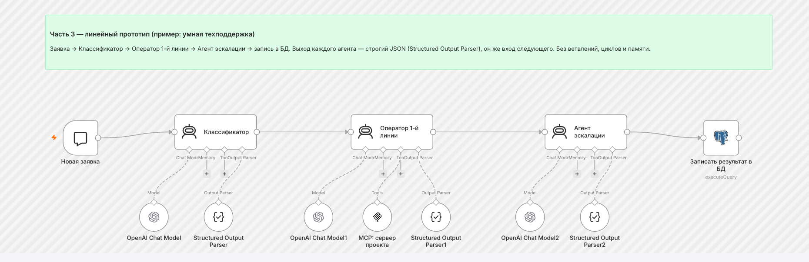

# Module 1 homework: the project's MCP server and the start of the course project

The first module's homework is an MCP server for the project's internal DB and the first three stages
of the course project, which you carry through to the end of the course.

## What to submit — the short version first

The question "do we need agents already?" — yes, we do. It is not just the server that is submitted: the work consists of three parts,
and all three are submitted together, in one repository.

| Part | What you do | What artifacts remain |
|---|---|---|
| 1. MCP server | A server over the project's internal DB: a tools contract, at least one resource, validation of status transitions | the server code, `README.md`, the DB's DDL and `seed.sql`, the validation rules in `report.md` |
| 2. Agents on paper | The roles of 2–3 project agents and their system prompts | `agents.md`, the `prompts/` directory |
| 3. Prototype in n8n | A linear chain of 2–3 agents, strictly sequential JSON handoff | the workflow export (JSON), observations in `report.md` |

In addition: `process-log.md` (how you worked with the agent), screenshots and the IDE dialogue log —
the full list is in the section ["What to submit"](#what-to-submit-and-acceptance-criteria), which is the source of truth
for what the submission contains.

## Deadlines and submission format

**Module 1 deadlines:** the theory took place on August 3, the practice is on Friday **August 14**, submit
by Sunday **August 16** inclusive. It is advisable to come to the practice with the work finished or nearly
finished: in the session we review what did not work out and fix it by hand. Keep in mind that
on Monday, August 10, the theory of the second module arrives with its own homework. If you see that
you will not make it, write in advance, not on the submission day.

**Submission format:** one GitHub repository. The repository is **private** — you do not need to publish the work
and you do not need to fork the course repository. Give read access to the teacher's account
**[`Serg1Kk`](https://github.com/Serg1Kk)**, and paste the repository link into the field at the bottom
of this assignment in the LMS and send it with the button: feedback is written there too and attached to your submission.
In `report.md`, state which level you are submitting at — normal or advanced.

**Difficulty:** middle+ — you need L1-level experience (a basic MCP server, working in n8n with ready-made
nodes).

**Time:** normal — 6–8 hours with infrastructure ready, advanced — 10–12. This is two or three
sittings, not one evening: split the work along the steps in the "Order of work" section below.
The infrastructure (an n8n instance, provider keys, Node, Python or TypeScript, a DB client) is not included in this
estimate: set it up from the checklist before you start.

## Order of work

The dependencies between the parts are hard, so the order is this:

| Step | What | Why now |
|---|---|---|
| 0 | Set up an n8n instance and connect a provider key | The only step with external billing: it can run into payment or limits and take a day |
| 1 | Bring up the scaffold, run `selfcheck`, see it in Inspector | Separates an environment problem from a code problem. Five minutes |
| 2 | Choose a track, load the fixture, write the statuses and transition rules into `report.md` | Invariants are fixed before the code, otherwise the server will check what happened to come out, not what was intended |
| 3 | Part 1: the tools contract, resource, validation | Part 2 needs the tool names |
| 4 | Part 2: `agents.md` and prompts | Part 3 needs the prompts in full |
| 5 | Part 3: the chain in n8n, runs | Assembled from ready-made pieces |
| 6 | Finish `report.md` and `process-log.md`, attach screenshots | |

## How normal and advanced differ

You choose the level yourself; advanced is meant for those who came from L1 with ready MCP servers
and n8n pipelines. The acceptance criteria are the same — the scope differs.

| | normal | advanced |
|---|---|---|
| Tools | 3 | 5 |
| Resource | the DB schema | plus the resource template `db://entity/{id}` |
| Server state between calls | in process memory is acceptable | outside the process (a file, SQLite or Redis) plus an explanation in `report.md` of what will happen behind a load balancer |
| Transport | stdio | plus Streamable HTTP with a check of the `Authorization: Bearer <token>` header |
| Calling a tool from n8n | the MCP Client Tool node via the supergateway bridge, or the HTTP Request Tool to your own wrapper over the DB | the MCP Client Tool node directly: the server itself serves Streamable HTTP with a bearer |
| Agents in the chain | 2 | 3 |
| Runs | 2: a normal one and a problem one | 3 plus a mini-dataset of 5–10 cases via the built-in Evaluations |

**Explanation of the table rows.**

- **Resource** — the second MCP primitive alongside tools. A tool is an action the agent decides
  to call; a resource is a piece of reference context that the client puts in front of the model by URI,
  without spending a tool call. The DB schema and a summary of counters by status are typical resources.
- **Resource template** — the same resource, but with a parameter in the URI: not one fixed address,
  but a template. `db://entity/{id}` means that the client requests `db://entity/7` and gets
  the record card with `id = 7`. How this is registered in code is in the scaffolds' READMEs, section
  "What to change for your own project": [Python](starter-server/python/README.md#what-to-change-for-your-project),
  [TypeScript](starter-server/typescript/README.md#what-to-change-for-your-project).
- **Server state between calls** — data the server holds from one tool call
  to the next: a draft, an intermediate result, an attempt counter. At normal it is
  enough to keep it in process memory: there is one server, launched over stdio, living exactly as long
  as the client is open. At advanced the same state is moved outside the process — into a file,
  SQLite or Redis — and `report.md` gets a paragraph on what will happen when there are several such
  servers behind a load balancer and the agent's next request lands on a different
  instance. The breakdown by state layers and the choice of storage are in the guide
  [Protocol revision 2026-07-28](guides/protocol-revision-2026-07-28.md), the section "Where
  server state lives after sessions are removed".

The number of tools is a guideline, not an acceptance criterion: you can design three tools
that cover more scenarios than seven. The contract is what is assessed, not the counter; the justification
of your set goes in `report.md`.

## Preparation

### Environment: check before you start

Parts 1 and 3 silently require working infrastructure. If it is not there, that is a separate evening on top of the
time estimate, so go through the checklist in advance:

- an n8n instance of the 2.3x branch (Cloud or self-hosted) and a login to it. **If you take Cloud, decide
  right away how the cloud will reach your machine:** neither a local MCP server nor a local SQLite
  is visible from Cloud. Working options are a tunnel (for example, Cloudflare Tunnel), a deployed
  server instance, or a database in managed PostgreSQL. Self-hosted n8n next to your DB removes
  the question entirely and is simpler for this homework;
- credentials for at least one LLM provider, connected in n8n;
- Node.js — needed to run MCP Inspector via `npx`;
- Python 3.10+ or Node for the server itself (exact versions are in the README of your language's scaffold);
- a DB client (SQLite or Postgres) and access to the database.

You can check the whole environment in five minutes: this folder contains a
[starter scaffold](starter-server/) — a server with one tool and one resource in
[Python](starter-server/python/) and in [TypeScript](starter-server/typescript/), which
launches and is visible in Inspector. If the scaffold came up, the environment is ready; after that you replace its
contents with your own contract. Both implementations have a `selfcheck` — it separates an environment problem
from a code problem.

### Stack barrier: what to write the server in

The assignment requires Python or TypeScript. If your working stack is different — Java, .NET, Go — take
Python: you need a decorator over a function with type annotations, and the schema and validation are generated for you.
Switching languages is cheaper here than it seems: the protocol part is the same, and this assignment
focuses on the contract, not on the language.

### Module theory

Before coding, rely on two topics of the module — LMS 1.1 (MCP primitives, tool design, DB integration,
MCP Inspector, deployment) and LMS 1.2 (the AI Agent node, structured output at node boundaries,
the request-handling pipeline as a chain template). The [module slides](slides/) are next to this file, the guides on the
topics are embedded in them and duplicated in [`guides/`](guides/). Primary sources with links
and dates, as well as a list of claims for which a primary source was searched for and not found, are
in [`reading-list.md`](reading-list.md).

### The guides are artifacts for your agent

The module's guides are written as instructions to be fed to a coding agent during
planning. Put the ones you need into your repository and connect them at the design stage —
the agent will build in best practices right away, and you will not have to redo it later:

| When | Guide |
|---|---|
| You are designing the tools contract | [Tool design](guides/tool-design.md) |
| You are building in security and authorization | [Security and authorization](guides/security-and-authorization.md) |
| The server will be used by several clients or organizations | [Multi-tenancy](guides/multi-tenancy.md) |
| You are thinking about how to live with contract changes | [Versioning your server](guides/versioning.md) |
| You are building in metrics and tracing | [Observability](guides/observability.md) |
| You are choosing SDK versions and the protocol revision | [Protocol revision 2026-07-28](guides/protocol-revision-2026-07-28.md) |
| You are building the chain in n8n and thinking about when to move to code | [The low-code / code boundary](guides/low-code-boundary.md) |

You do not need to dig into security and multi-tenancy on the first homework: the requirement is to
lay down the architecture so that you do not have to redo it later. This layer will be refined and checked
in module 7 on your own server.

### Where to start if you lack experience

The cohort's background is uneven, and that is normal. Two short routes.

**If you have never written an MCP server.** Do not start by designing the contract. The order
is this: bring up the scaffold in your language and run `selfcheck` — at this step you will see what the
server returns over the protocol. Then open it in Inspector and call a tool by hand.
Then read `server.py` (or `server.ts`) in full, it fits on a screen: there are exactly three
things there — the server declaration, one tool via a decorator and one resource. After that replace the
starter tool with your first tool and check it in Inspector. The three tools
will appear on their own once the first one works.

**If you have never opened n8n.** Set up an instance and connect a provider key **before**
everything else: this is the only step of part 3 that can run into billing and take
a day. Next, build a chain of one agent: Chat Trigger → AI Agent → nothing. Check
that it responds. Then attach a Structured Output Parser to it and make sure the output
is JSON, not text. Only after that add a second agent. Assembling the whole
chain at once and then looking for where it breaks is more expensive than growing it node by node.

## Choosing the course project and its internal DB

Choose one of four projects — it stays your course project until the end of the course. Each has
a key entity with state assigned to it, which the MCP server will manage:

| Project | Agent chain | Key entity | Status transitions |
|---|---|---|---|
| AI newsroom | Author → Fact-checker/Editor → SEO | article | draft → checked → published |
| Smart tech support | Classifier → First-line operator → Escalation agent | ticket | new → answered → escalated |
| DevTools assistant | Diff reviewer → Tester → Documenter | review task | queued → reviewed → tested |
| Knowledge curator | Collector → Rater → Summary composer | knowledge source | collected → rated → summarized |

**Your own project instead of a suggested one is also acceptable** — agree the topic with the teacher
(in the course chat or in a direct message) and define the same kind of key entity with statuses for it.

The common fields of any entity: `id`, `status`, a numeric score 0–100, `last_modified`.
The further preparation steps:

- populate the DB (SQLite or Postgres) with 10–20 realistic records of your domain. For each
  of the four tracks, [`fixtures/`](fixtures/) holds a starter fixture — DDL separately for
  SQLite and for PostgreSQL plus 20 records in a shared `seed.sql` — so you do not spend time
  inventing data. The load commands as a one-liner are in [`fixtures/README.md`](fixtures/);
- record in `report.md` the allowed status transitions and validation rules **before writing
  the code**. These are invariants — statements that must remain true after any
  operation, whatever the agent asks for. The server enforces them, rather than checking itself against them.

The project idea is worth putting into the repository right away, rather than keeping it in a conversation with the agent:
[`planning/`](../planning/) holds templates for the five levels of planning, ready-made prompts for
the agent and filled-in examples for all four tracks.

## Part 1 — an MCP server for the project's internal DB

An L2-level server: a thought-out tools contract, resources and transition validation, not a wrapper
over every SQL query.

### Server contract

The requirement for the server is set as an invariant, not as a list of functions:

> The server must let an agent without hints take the entity through its lifecycle
> and must not allow an invalid transition. Which set of tools ensures this is for you to decide;
> the guideline is 3 tools at the normal level and 5 at advanced, the justification of the choice goes in `report.md`.

**Resource** (at least one): the DB schema or a state summary (counters by status) —
reference context that the model receives without a tool call. At advanced, add a resource
template of the form `db://entity/{id}`.

**Tool descriptions** — per the canon from the tool design guide: what it does, when to call it, when
NOT to call it, the input and output format, one or two examples. Critical constraints go in the imperative
(You MUST). Write the "when NOT to call" section as a precondition or a redirect to another
tool, not as a bare prohibition: the model must see what to do instead. A ready skeleton
of a description and a filled-in sample are in
[Appendix A](guides/tool-design.md#appendix-a-tool-description-skeleton), templates
for error texts are in Appendix B, and the self-check checklist before submission is Appendix C of the same
guide.

**Errors — correctable by the model.** An invalid status transition returns the list of allowed
transitions, not a bare rejection: the model must be able to correct itself, without a human stepping in.

**Advanced: state outside.** If your tools hold anything between calls, move
it out of process memory (a file, SQLite or Redis) and describe in `report.md` the behavior with
several instances behind a load balancer — details are in the explanation of the levels table above.

### Implementation and checking

The language is Python or TypeScript (see "Stack barrier" above); within the chosen language the stack is up to
you. Record your choice and the exact SDK version in `README.md`. The version fork
matters more here than it seems: both official lines released major versions at the end of July 2026
and behaved differently. The exact versions, dates and both traps — `mcp` versus `fastmcp` in Python
and `@modelcontextprotocol/sdk` versus the second-line packages in TypeScript — are covered in the README
of the [scaffolds](starter-server/) and in the [protocol revision guide](guides/protocol-revision-2026-07-28.md).

**Check 1 — MCP Inspector.** Take the current line of
[MCP Inspector](https://modelcontextprotocol.io/docs/tools/inspector) — as of July 2026 that is 2.x.
The historical minimum 0.14.1 closed
[RCE CVE-2025-49596](https://github.com/modelcontextprotocol/inspector/security/advisories/GHSA-7f8r-222p-6f5g),
but it was followed by CVE-2025-58444, closed only in 0.16.6 — so pinning to the old
minimum version is unsafe. Make sure all tools are visible, the schemas are valid, manual calls
go through, and the errors are meaningful.

**Check 2 — from your IDE** (Claude Code or Cursor). Write the test scenario yourself
and attach it to `report.md`: it must check both a successful pass of the entity through the lifecycle
and a rejection on an invalid transition. There is intentionally no ready list of calls here — designing
the checking scenario is the most valuable exercise of part 1.

If the agent mixes up the order or ignores a tool, this is fixed with tool descriptions, not
code. Refine the descriptions and record in `process-log.md` the whole chain of edits: which
wordings you tried and which one fixed the behavior.

## Part 2 — agent roles and system prompts

Stage 2 of the course project is designing a multi-agent system on paper, before any agent
code.

### Role map

Put together `agents.md`. For each of the project's 2–3 agents:

- purpose — one sentence;
- input and output — a JSON structure with fields and types;
- tools — which are needed, including the tools of your MCP server from part 1;
- the step's success criterion.

Additionally, for each agent:

- **explicit boundaries** — what the agent does NOT do and who it hands off to (the Author does not check facts, that is the
  Fact-checker; the First-line operator does not resolve payment questions, that is the Escalation agent);
- **failure points** — what to do on invalid input or an uncertain result: retry,
  flag or escalate.

`agents.md` is one file in the repository root, not a folder. The structure for each agent is
the same, the skeleton is copied as is:

```markdown
## Agent 1. <Role name>

**Purpose:** <one sentence: what it does and what it is for in the chain>

**Input:** <JSON structure with fields and types>
**Output:** <JSON structure with fields and types; enum where values are enumerable>

**Tools:** <which are needed, including the tools of your MCP server by name>

**Step success criterion:** <how you can tell the step worked rather than produced plausible text>

**Boundaries:** <what the agent does NOT do and who it hands that to — by the next agent's name>

**Failure points:**
- invalid input → <retry / flag / escalate>
- uncertain result → <what counts as uncertainty and what to do>
```

A filled-in sample of the table of contracts between roles is in the planning examples:
[`planning/examples/smart-support/backlog/feature-3-agent-roles/README.md`](../planning/examples/smart-support/backlog/feature-3-agent-roles/README.md).

### System prompts

One prompt per agent, following the structure from the module's lectures: role and context; rules
and constraints; output format — a JSON schema with enumerable values; one or two input-output
examples.

You do not have to write the prompts from scratch: the repository holds the skill
[`ai-agent-builder`](../skills/ai-agent-builder/) — it will walk you through all the questions (input
data, each agent's output, tools) and assemble a system prompt with structure, constraints
and examples. It works both for agents with tools and for simple chain steps without them.
How to install it — [`skills/README.md`](../skills/README.md).

Prohibitions go as explicit items: do not invent facts, do not change other agents' JSON fields, do not answer outside
the format. These are the future checks in the module 5 evals, so phrase them so they can be checked.

The prompts go in separate files `prompts/<agent>.md` in the repository. This version starts their
evolution, which you track until the end of the course.

## Part 3 — a linear prototype in n8n

Stage 3 of the course project is a chain of 2–3 agents that hand work off strictly sequentially.
If you only manage two agents, that is acceptable: the module's focus is the MCP server that
this chain calls; the third agent can be added later.

For those who have worked little with n8n, the repository holds two helper agents:
[`n8n-requirements-orchestrator`](../agents/n8n-requirements-orchestrator.md) works through
requirements and the workflow design, and [`n8n-workflow-builder`](../agents/n8n-workflow-builder.md)
builds the workflow JSON from them. How to connect them — [`agents/README.md`](../agents/README.md).

### Building the chain

This is what an assembled chain looks like on the n8n canvas — an example for the smart tech support track,
three agents, with a tool connected to the middle one:



The model and the Structured Output Parser are not links of the chain but sub-nodes: they connect to the agent
from below, via the diamonds. The arrow between agents is the whole data exchange: the JSON from the first one's output
arrives in full at the second one's input. There are no branches and no backward arrows.

This is a guideline, not a sample to copy. Make the input whatever is convenient — chat, webhook, any
UI of your own; arrange the DB write your own way too: it can be one final node, or you can
update the record along the chain. The export of this workflow is in
[`examples/n8n-linear-chain-example.json`](examples/n8n-linear-chain-example.json) — you can
import it into your own instance (Workflow → Import from File) and go through it node by node.

**The trigger** accepts the domain's input: an article topic, a request text, a diff or a link to a source.
Take the [Chat Trigger](https://docs.n8n.io/integrations/builtin/core-nodes/n8n-nodes-langchain.chattrigger/)
if you want to drive the chain by hand from a chat window — that is more convenient for this homework; a Webhook is needed
only if the input comes from an external system. This input is a new unit of work for the DB's key
entity from part 1: in tech support, the incoming request is the ticket that the chain takes
through the statuses new → answered → escalated.

**Each agent** is an
[AI Agent node](https://docs.n8n.io/integrations/builtin/cluster-nodes/root-nodes/n8n-nodes-langchain.agent)
with the system prompt from part 2 (the System Message option) and a
[Structured Output Parser](https://docs.n8n.io/integrations/builtin/cluster-nodes/sub-nodes/n8n-nodes-langchain.outputparserstructured).
The output of agent N is the input of agent N+1: data flows strictly along the chain. Decide in advance what
happens when no JSON arrives: a parser failure at the boundary between agents is the most common pit of this
part. The working minimum is a retry with the error text in the next pass's prompt and an enum instead of
free strings in the schema; describe the failure scenario in `report.md`.

**No branches or loops** — this is a constraint of the assignment, not of n8n: you will add branches, loops and memory
at stage 5, in
[LangGraph](https://docs.langchain.com/oss/python/langgraph/use-graph-api). What is needed here is a clean
linear baseline for comparison. Memory is not needed here either: think of the chain as a pipeline
that runs once and leaves a result.

**At least one agent calls a tool.** Your server from part 1 runs over stdio, while the
[MCP Client Tool](https://docs.n8n.io/integrations/builtin/cluster-nodes/sub-nodes/n8n-nodes-langchain.toolmcp/)
in n8n connects over HTTP — they do not connect directly. So choose one of the paths:

- **normal, the recommended path:** the [supergateway](https://github.com/supercorp-ai/supergateway) bridge,
  which brings up your stdio server behind Streamable HTTP with one command:
  `npx -y supergateway --stdio "<command that launches your server>" --outputTransport streamableHttp --port 8000`.
  Nothing changes in the server code, and the chain calls exactly it via MCP Client Tool.
  The endpoint for the node is `http://localhost:8000/mcp`; if your n8n runs in Docker,
  write `host.docker.internal` instead of `localhost`. The bridge holds the connection on protocol
  revision 2025-11-25, not 2026-07-28 — acceptable for this homework, details are in the README
  of the scaffolds;
- **normal, if the bridge did not start:** the
  [HTTP Request Tool](https://docs.n8n.io/integrations/builtin/core-nodes/n8n-nodes-base.httprequest) node
  to your own thin HTTP endpoint over the same DB. This is a separate small service that
  you will have to write — allow an hour for it on top of the estimate. A ready-made n8n tool instead of
  your own is also accepted, but then write in `report.md` why you went this way: the chain
  in this variant does not touch your server;
- **advanced:** add the Streamable HTTP transport to the server and a check of the
  `Authorization: Bearer <your token>` header on entry, then connect it with the MCP Client Tool node.
  A ready tested recipe for both stacks is in the scaffolds' README, section "Running over
  Streamable HTTP"; the tool logic does not change, only the launch changes.
  What gets enabled on the security side together with the HTTP transport — the guide
  [Security and authorization](guides/security-and-authorization.md).

A reminder for n8n Cloud (more in the environment checklist): the server must be reachable
from the internet — a tunnel or a deployed instance; the cloud will not see a local localhost.
The AI Agent node has no built-in web search: it lives in a separate n8n product, n8n Agents,
and cannot be connected as a tool of a cluster node.

**A run leaves a trace in the project's DB** — in the same data that the server manages.
How exactly is up to you: the final node writes the result (via an MCP tool or
directly) or the agents update the record along the chain.

### Checking the prototype

- **Runs with different inputs.** At the normal level — two, one of which is deliberately problematic
  (a weak topic, an empty request, a broken diff); at advanced — three.
- **The expected output is fixed before the run.** Write it down for each run and note
  the discrepancies — this is the cheapest way to tell a measurement from an impression. At advanced, the labeled
  mini-dataset plays the same role, but for the three manual runs the expected output is still
  written down.
- **Mini-dataset via Evaluations (advanced).** Collect 5–10 labeled inputs and run the
  chain through the
  [built-in Evaluations](https://docs.n8n.io/build/integrate-ai/test-and-improve-ai-workflows/understand-why-to-test)
  (the dataset lives in a separate Evaluations tab of your workflow), and attach a screenshot
  of the metric cards. This is the seed of your eval set for M5, so take real cases.
- **Return Intermediate Steps** — an option in the Options of the
  [AI Agent](https://docs.n8n.io/integrations/builtin/cluster-nodes/root-nodes/n8n-nodes-langchain.agent/tools-agent/) node;
  turn it on and look at the trace: where the agent called a tool, where the prompt failed to hold the format.
- **Observations in `report.md`** — briefly: what the chain does well, where the format breaks at
  the boundary between agents, and what control (loop, branching, memory) this linear
  prototype is already missing. This is your personal list of requirements for LangGraph in module 3.

## Where it usually breaks

A short collection of rakes that most people step on. Detailed walkthroughs are in the scaffolds' READMEs
and the fixtures':

- **`mcp` versus `fastmcp` in Python** — two different packages, and mixing the imports is the most common
  startup error. Covered in the [Python scaffold README](starter-server/python/README.md);
- **`print()` to the stdout of a stdio server breaks the protocol** — any stdout output gets mixed
  with JSON-RPC; log to stderr. Same place;
- **`@modelcontextprotocol/sdk` in TypeScript is v1**, the second line lives in other packages.
  Covered in the [TypeScript scaffold README](starter-server/typescript/README.md);
- **a parser failure at the boundary between agents** — the most common pit of part 3; the working minimum is described
  in the section "Building the chain";
- **n8n Cloud does not see localhost** — neither your server nor a local SQLite; see the environment
  checklist;
- **A Python server answers 421 to a request from Docker** — the Python SDK has DNS rebinding
  protection on by default, and `Host: host.docker.internal` is bounced before any logic; from n8n
  this looks like "the tool does not respond". The fix is in the
  [Python scaffold README](starter-server/python/README.md), section "Running over Streamable HTTP";
- **`seed.sql` does not apply on top of already loaded data** — the order of commands is in the
  [fixtures README](fixtures/);
- **the AI Agent node has no built-in web search** — tools are connected only explicitly.

## What to submit and acceptance criteria

### Three parts in one repository

Put the three parts together and submit them as one private GitHub repository with access for
[`Serg1Kk`](https://github.com/Serg1Kk). Send the link in the answer field in the LMS or in the course chat.
State in `report.md` which level you are submitting at — normal or advanced.

What to attach:

- **GitHub repository:** the MCP server code, `README.md` (stack, SDK version, launch,
  connection), `agents.md`, prompts as separate files `prompts/<agent>.md`, the n8n
  workflow export in JSON, `report.md` (the full contents are in the next section);
- **project data:** the DDL and `seed.sql` of your database in the repository (do not commit the database
  file itself, add it to `.gitignore`), so the reviewer can bring up the database with one command;
- **`process-log.md`:** how you set the task to the agent, what steps you split it into, how you checked
  the result at each step. An export of the session from your IDE plus 10–15 lines in your own
  words is enough;
- **a screenshot** of the server's tools in MCP Inspector or the IDE and the IDE dialogue log with the chain
  of calls from your test scenario;
- **a screenshot** of a successful execution of the chain in n8n with the step trace visible;
- **a screenshot of the Evaluations metric cards** — for advanced only.

### What to write in report.md

The requirements for this file are scattered across the assignment, so here is the full contents as one list.
The sections are copied as headings:

```markdown
# Module 1 homework report

## Submission level
normal or advanced.

## Product framing
Whose work this chain takes off their plate; how much of this work there is per week now; by what sign
you will understand that it works.

## Project and data model
Track, key entity, fields, statuses.

## Validation rules
The allowed status transitions and invariants. Written before the code.

## Tools contract
Which set of tools you chose and why exactly this one. The counter does not matter, what matters is coverage
of the lifecycle.

## Part 1 test scenario
The sequence of calls you checked: a successful pass through the lifecycle
and a rejection on an invalid transition. The result of each step.

## Chain runs
For each run: the input, the expected output written BEFORE the run, the actual output,
the discrepancies.

## Behavior on format failure
What the chain does when no JSON arrives from an agent.

## Observations
What the chain does well, where the format breaks at the boundary between agents, what control
(loop, branching, memory) this linear prototype is already missing.

## Advanced only
Where the server state lives and what happens with several instances behind a load balancer.
```

By M7 the product framing will become the baseline for computing agent economics, rather than a number
invented after the fact. If you keep the project plan using the templates from [`planning/`](../planning/),
you already have the framing in the vision — an extract is enough here.

### Acceptance criteria

- [ ] The MCP server launches per `README.md`, the tools are visible in Inspector and the IDE; your test
      scenario passes without manual hints during the dialogue.
- [ ] Validation works: an invalid status transition is rejected with a meaningful error;
      the tool descriptions contain both "when to call" and "when not to call".
- [ ] `agents.md` — each agent has input and output as a structure and explicit boundaries
      of responsibility; the system prompts are in separate files.
- [ ] The n8n chain is linear, each agent boundary is structured JSON; runs are attached
      per the norm of your level, including the problematic one; the observations in `report.md` are filled in.
- [ ] There is at least one resource: the DB schema or a state summary.
- [ ] At least one agent of the chain calls a tool, and the run leaves a trace in the project's DB.
- [ ] `report.md` has the product framing and the expected output of each run written before
      the run.
- [ ] The process is visible: `process-log.md` has a plan before the code, a split into steps and a way of checking
      each step.
- [ ] The advanced level (if you submit it): the resource template `db://entity/{id}`, state outside the
      process with an explanation of the behavior behind a balancer, the Streamable HTTP transport with
      a bearer token check, the call via MCP Client Tool, a third agent, a mini-dataset
      in Evaluations with a screenshot of the metric cards.

## The course project map: how results are reused later

The course project is built in layers: each next module does not start over but builds on what
you submitted earlier. Stages 1–3 are the content of the current assignment.

| Stage | Module | What you do | What artifact remains |
|---|---|---|---|
| 1 | M1 | The project data and an MCP server over it | the project DB, the server code, README, the validation rules in `report.md` |
| 2 | M1 | Agent roles and system prompts on paper | `agents.md`, the `prompts/` directory |
| 3 | M1 | A linear prototype of 2–3 agents in n8n | the workflow export (JSON), observations in `report.md` |
| 4 | M2 | RAG on [Qdrant](https://qdrant.tech/documentation/), knowledge base tools | the server is extended, not rewritten |
| 5 | M3–M4 | Moving to [LangGraph](https://docs.langchain.com/oss/python/langgraph/overview): loops, memory, routing | the code version of the system plus the n8n baseline for comparison |
| 6 | M5–M6 | Evals and tracing from the prompts and the boundaries of `agents.md` | an eval set, a trace dashboard |
| 7 | M7 | Agent economics from the traces of this same system; a security audit of the server — [tool poisoning and rug pull](https://invariantlabs.ai/blog/mcp-security-notification-tool-poisoning-attacks) are checked on your code | a cost calculation, an audit report |

The stricter the tools contract and the agent boundaries are now, the cheaper each next
module comes out.

## How to submit your work

At the bottom of this assignment in the LMS there is one input field. Paste into it the link to your private
repository and press the submit button. Nothing else needs to be added to this field:
the work itself lives in the repository.

Submit your work exactly this way, even if you already sent the link to the course chat. Feedback
is written in the LMS and attached to your submission: anything sent outside this field is left without feedback
and without a mark.
