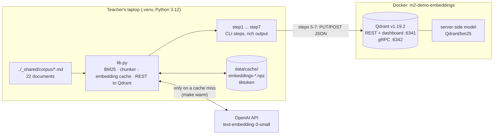

# Demo M2-01: embeddings from scratch and filling a vector DB step by step

Twelve small CLI steps, each showing one idea of the M2 basics next to the slides: step 0 sets up the corpus and the golden set, steps 1-7 go from BM25 to a loaded Qdrant, steps 8-11 measure search and answers and swap the embedding model. It is a teaching demo, not a homework solution: it shows the shape of what the homework asks for on a fictional corpus. Each one prints tables (`rich`) and a one-line takeaway. The corpus is 22 English-language documents about the fictional SaaS "Lumen" from `../_shared/corpus/` (read-only).

The presentation script, the real output and the fallback moves are in [RUNBOOK.md](RUNBOOK.md).

## What the demo proves

| Step | Command | What you see on screen | Part of the lecture | Homework (`M2/homework.md`) |
|---|---|---|---|---|
| 0 | `make step0` | The corpus by section (22 documents, 49,452 tokens, front matter), the two corpus rules checked on the files (5 of 5 facts in exactly one document, 0 trap topics in the corpus), the golden set: 10 core, 5 two-document, 2 traps | 7 · Golden set (slide 49) | part 1: corpus for a role, metadata, golden set with traps |
| 1 | `make step1` | Inverted index, IDF (0.134 for a word present in all documents vs 0.981 for a rare one), BM25 saturation (tf=10 gives 1.93 instead of the 9.81 of TF-IDF), zero on "can't log in" and on Russian | 1 · Search before LLMs | beyond the homework: why the sparse branch exists |
| 2 | `make step2` | A vector of 1536 numbers, norm 1.0; "I can't log in" is closer to "How do I reset my password?" (0.47) than to a billing invoice (0.27), with zero words in common; cosine = dot | 2 · Embeddings | beyond the homework: what the dense branch is |
| 3 | `make step3` | BM25 and dense (brute force in numpy) over 147 chunks for three questions: an error code, a paraphrase, a Russian question | 1, 2, 4 · who wins where | part 2: why the query is hybrid |
| 4 | `make step4` | Splitting by H2 with a target of ~400 tokens: 147 chunks, min/avg/max 155/341/496, a histogram, the real overlap share, 58 of 58 tables and 27 of 27 code blocks kept whole, a chunk with the "Title > Heading" prefix | 7 · RAG as a system: chunking | part 2: chunking by structure, 300-500 tokens, overlap, tables and code not split |
| 5 | `make step5` | The collection as in the homework (unnamed dense 1536 Cosine + sparse `bm25` with `modifier: idf`), payload index, uuid5 ids, batched upsert with `wait=true`, a check of count and of one point | 3 · Vector DB, homework part 2 | part 2: collection schema, recreated by one command, model name in the metadata, payload `content` + `metadata`, batch upsert, chunk id |
| 6 | `make step6` | dense / bm25 / hybrid (prefetch + RRF) via `/points/query` side by side; the "Salesforce" trap gets a dense score higher than the three questions of this step; RRF recomputed by hand matches Qdrant | 5 · Hybrid and RRF | part 2: hybrid query through `/query`; part 3: why the refusal is the agent's job |
| 7 | `make step7` | Re-ingesting a changed document: same ids → count does not change; random ids → duplicates; no delete → an orphan with the same count; delete by `source` + upsert → clean | 7 · RAG as a system: stable ids | part 2: the chunk id formula for document updates |
| 8 | `make step8` | The shared golden set (17 questions) through dense, bm25 and hybrid: position of the answer document per question, recall@5 / recall@10 / NDCG@5 per search, NDCG worked out by hand, the worst question (m03, two intents), the metrics table for `report.md` | 7 · Evaluating retrieval | part 2: recall@5 ≥ 0.8 with your own code; block A: recall@10, NDCG@5, two-document questions; part 3: the worst question |
| 9 | `make step9` | Block A before/after: RRF weights 1:1 / 3:1 / 1:3 on the same collection; chunkings 400 / 300 / 300 + 12% overlap / 500 in a temporary collection; delta tables and the before/after table for `report.md` | 7 · Evaluating retrieval | block A: one before/after experiment (weights or chunk size) |
| 10 | `make step10` | Four golden questions through the hybrid top 5 and `gpt-4o-mini` with a "facts only, cite or refuse" prompt: q02 answered with its source, the Salesforce trap refused, m01 answered from two documents, m03 partial (the search found 1 of 2 documents); the run table and the worst question diagnosed layer by layer | 7 · Answer and refusal (slides 50, 62) | part 3: answers with `source`, refusal on traps, analysis of the worst question |
| 11 | `make step11` | The same question through OpenAI (1536), Ollama `bge-m3` (1024) and FastEmbed `bge-small-en-v1.5` (384); a bge-m3 vector sent to the OpenAI collection → `400 Vector dimension error`; one collection per model; the models on the golden set (dense two-document NDCG@5: 0.785 / 0.893 / 0.752) | 2 · Embeddings (slides 70-72) | part 2: the embedding model and its paths (OpenAI, Ollama, FastEmbed), the same model in ingestion and search |

Steps 6-11 start with a collection check: if `metadata.embedding_model` or the vector size of the collection differs from the code, the step stops with a message instead of returning meaningless results (the first item of the homework's "Where it usually breaks").

## Homework coverage

What of `M2/homework.md` this lab shows, and what it leaves to other labs.

| Homework requirement | Where |
|---|---|
| Qdrant from Docker, Web UI, everything through `/query` | `make up`, `make dashboard`, steps 5-9 (port 6341 here, 6333 in the homework) |
| Unnamed dense + named sparse `bm25` with `modifier: idf` | step 5.1 |
| Collection recreated by one command; embedding model name in its metadata and checked before every run | step 5.0-5.1; the check at the start of steps 6-11 |
| Chunking by headings, 300-500 tokens, overlap 10-15%, tables and code not split | step 4 (overlap fires only on the 2 split sections, ~0.04% of all tokens: reported as is); step 9 (300 tokens + 12% overlap) |
| Payload `content` + `metadata` (`source`, `title`, `section`, `date`), batch upsert | step 5.5 |
| Stable chunk id for document updates | steps 5.4 and 7 |
| Hybrid: `prefetch` dense + sparse, RRF | step 6 |
| A corpus for the project's role, about 15 documents, Markdown, `source` / `title` / `section` / `date` | step 0 (22 documents, the rules that make it measurable) |
| Golden set: 10 questions + 2 traps (+ 5 two-document for block A), written before the pipeline | `../_shared/golden.json`, steps 0 and 8 |
| Embeddings: OpenAI, Ollama or FastEmbed; the same model in ingestion and search | default OpenAI everywhere; step 11 shows Ollama and FastEmbed and the wrong-model error |
| recall@5 ≥ 0.8 with your own code | step 8 |
| Block A: recall@10, NDCG@5, two-document questions, one before/after experiment | steps 8 and 9 |
| Analysis of the worst question | step 8 (search side), step 10 (answer side) |
| Refusal on traps, sources in the answer | step 10 on four questions (prompt, answer, run table); the full run through an n8n agent is Lab 05 (`../05-n8n-rag`) |
| n8n: Qdrant Vector Store node as an agent tool, top-k 5 | not here: Lab 05 |
| Block B: CAG versus RAG | not here (topic 2.1) |

Beyond the homework, kept for understanding: BM25 by hand and per-word breakdowns (steps 1, 3), what an embedding is and cosine vs dot (step 2), the server-side BM25 tokenizer, segments, WAL and `wait` (step 5 with `DEMO_EXPLAIN=1`), RRF recomputed by hand and the `k` constant (step 6).

## Architecture



## Components and ports

| Component | Where | Port | Why |
|---|---|---|---|
| Qdrant `qdrant/qdrant:v1.19.2` | Docker, project `m2-demo-embeddings`, volume `qdrant_storage` | `127.0.0.1:6341` (REST and `/dashboard`), `127.0.0.1:6342` (gRPC, not used by the scripts) | Steps 5-7 |
| Python scripts | host, `.venv` (Python 3.12, `requirements.txt` with pins) | — | All steps |
| OpenAI `text-embedding-3-small` | cloud | — | Only `make warm` or a cache miss |
| OpenAI `gpt-4o-mini` (`DEMO_CHAT_MODEL`) | cloud | — | Step 10, only on the first run (answers cached in `data/cache/answers.json`) |
| Ollama `bge-m3`, FastEmbed `BAAI/bge-small-en-v1.5` | host (Ollama at `localhost:11434`, FastEmbed inside Python) | 11434 | Step 11, only during `make warm`; afterwards from the cache |

Why the scripts run on the host and not in the `demo` container: in a lecture, speed and predictability matter. There is no image build, no cache mounting and no network plumbing between containers, and the `rich` output goes straight to the teacher's terminal. Only Qdrant lives in Docker.

The environment variables are called `DEMO_QDRANT_URL` and `DEMO_COLLECTION`, not `QDRANT_URL`: in neighboring projects `.env` often sets `QDRANT_URL=http://localhost:6333`, and the demo would silently go to someone else's Qdrant.

## Files

| File | What is inside |
|---|---|
| `docker-compose.yml` | Qdrant v1.19.2 on 6341/6342 with a healthcheck |
| `Makefile` | `setup`, `up`, `warm`, `step1`...`step7`, `all`, `dashboard`, `status`, `down`, `clean`, `distclean` |
| `requirements.txt` | httpx, numpy, openai, rich, tiktoken with pins |
| `.env.example` | `OPENAI_API_KEY` and optional `DEMO_*` |
| `lib.py` | Corpus loading, tokenizer and BM25, chunker, embedding cache with retries on 429, REST to Qdrant, the questions for steps 3 and 6 |
| `step1_bm25.py` ... `step7_reingest.py` | The lecture steps |
| `step0_corpus.py` | The corpus and the golden set; needs neither Qdrant nor the API |
| `step8_eval.py`, `step9_experiment.py` | Retrieval metrics on the golden set and the block A experiments; the golden set is `../_shared/golden.json` (read-only) |
| `step10_answers.py`, `step11_models.py` | The answer by a chat model with refusal; other embedding models (Ollama, FastEmbed) |
| `warm.py` | Computes all embeddings in advance: 670 OpenAI texts (315 unique, including the step 9 chunk variants) and 163 texts for each of the two local models of step 11 |
| `data/cache/` | Embedding caches, one file per model (key is sha256 of the model and text), the step 10 answers (key is sha256 of the whole chat request) and the tiktoken dictionary. Deliberately not in `.gitignore`: it is an offline safety net for the lecture |
| `data/expected-output.txt` | The full output of `make all` from a real run — a fallback if the live run fails |

## Requirements

- Docker (Compose v2 with `--wait`).
- `uv` (installs Python 3.12 itself) or Python 3.12+ with `venv`.
- Optional, only to refill the step 11 cache: Ollama with `ollama pull bge-m3`; FastEmbed is installed by `make setup` and downloads its model (~70 MB) once.
- `OPENAI_API_KEY` only for the first run: the whole corpus is ~49k tokens, i.e. less than a cent; step 10 adds five chat calls. The key is taken only from the environment (or from `.env`, which the Makefile reads) and does not end up in files or output.

## Quick start

```bash
cd M2-Ilya/demo/01-embeddings
make setup                 # .venv + dependencies
make up                    # Qdrant at http://localhost:6341, waits for the healthcheck
export OPENAI_API_KEY=...  # or cp .env.example .env and put the key in
make warm                  # once: all embeddings into data/cache
make all                   # steps 0-11 in a row, about 15 seconds
make dashboard             # Web UI of the lumen_demo collection
make clean                 # stop Qdrant and delete the volume (the embedding cache stays)
```

After `make warm` the key is no longer needed: all steps work from the cache, without network (except Docker with Qdrant).

For self-study, add `DEMO_EXPLAIN=1` to any step (`make step3 DEMO_EXPLAIN=1`, or `make all DEMO_EXPLAIN=1`): after every table or sub-step it prints a "How to read this" note with the formulas worked out on the table's own numbers. Steps 1 and 3 also get a per-word BM25 breakdown, step 6 a worked RRF example. Without the flag the output is the lecture output, unchanged.

Ties in step 6: when two chunks get the same RRF score (for "What does E-4031 mean?" two chunks have 0.6667), Qdrant may return them in either order between runs, so the first two hybrid rows can swap compared with `data/expected-output.txt`.

## Observations and deviations

- The server-side BM25 model `Qdrant/bm25` works on v1.19.2: upsert and query pass `{"text": ..., "model": "Qdrant/bm25"}`, and Qdrant computes the sparse vector itself. FastEmbed was not needed.
- `{"fusion": "rrf"}` in Qdrant 1.19.2 computes `1/(k + rank)` with rank starting from 0 and k = 2 (step 6 recomputes this by hand). The parameter can be set explicitly: `{"rrf": {"k": 60}}` is accepted and gives 1/60 for first place. `M2/homework.md` says that k is not configurable in Qdrant — this is worth cross-checking.
- The own BM25 of steps 1 and 3 keeps codes like `E-4031` as a single token; `Qdrant/bm25` in step 6 has its own tokenization, so the scores of steps 3 and 6 do not match, although the order is close.
- The paraphrase "I'm a viewer..." did not become a dense win: the word `viewer` stayed in the question, and BM25 puts the right chunk first while dense puts the GDPR export first. On the slide this illustrates "similar does not mean relevant", not "dense is always better on paraphrases". A clean dense win comes from the Russian question.
- Chunk overlap is modest: when a long section is split, the last short paragraph (up to 60 tokens) is repeated. In this corpus two sections were split, both in `integrations-and-api`: `Available integrations` (503 tokens) and `Webhooks` (488 tokens, over the 484 left after the 16-token prefix reserve). So the overlap fired twice (the `### Slack` heading and the one-line intro to the E-5003 checklist); the other boundaries are headings. Merging neighboring short sections is sometimes impossible without exceeding 500 tokens, which is why 36 of the 147 chunks are shorter than 300 — step 4 shows this.
