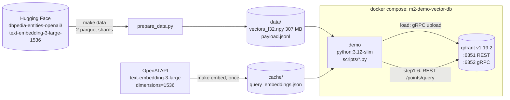
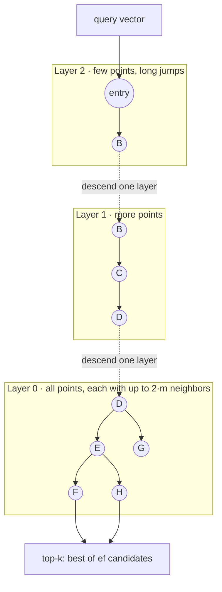

# Demo 02 · What happens inside a vector DB

Live demo for part 3 of the M2 lecture ("How a vector DB works"). Seven short steps on Qdrant `v1.19.2` and 50,000 real DBpedia articles with ready-made OpenAI embeddings. Each step is one command and prints a table of real measurements (recall, milliseconds, megabytes).

The delivery script, expected output and what to say are in [RUNBOOK.md](RUNBOOK.md).

## What it proves (by lecture point)

| Step | Command | What you see | Lecture thesis |
|---|---|---|---|
| 1 | `make step1` | A collection of 1,000 points: `indexed_vectors_count = 0`, `plain` segments, default search = brute force | At the homework scale (190 chunks) ANN does not even kick in; index tuning is for millions of points |
| 2 | `make step2` | 50,000 points: brute force ~93 ms vs HNSW ~4 ms (×22), recall@10 = 0.998 | Exact search grows linearly; HNSW is approximate but nearly exact |
| 3 | `make step3` | `hnsw_ef` 8 → 512: recall 0.90 → 1.00, time 1 → 15 ms; m=4: builds 3x faster, but recall 0.91 at ef=64 | Three HNSW knobs: `m`, `ef_construct`, `hnsw_ef` - speed vs recall |
| 4 | `make step4` | int8: RAM ×4 smaller, recall 0.976 → 0.996 with oversampling; binary: ×32, 0.70 → 0.96 | Quantization saves memory; rescoring against the originals on disk brings accuracy back |
| 5 | `make step5` | Post-filtering returns 0.1 of 10; without a payload index a narrow filter takes 70 ms vs 1 ms, a compound one returns 6 of 10 with recall 0.23; with an index - 10 of 10 and 0.95; ACORN lifts it to 1.0 | A filter is part of the search, not post-processing; payload indexes are created before loading |
| 6 | `make step6` | `acknowledged` vs `completed`; with `prevent_unoptimized` points become visible to search within seconds; delete leaves tombstones until vacuum | A write being "accepted" and being "searchable" are different moments; deletion is a mark |
| 7 | `make step7` | Memory table: 1M/10M × 1024/1536, float32/int8/binary, HNSW, ×2 replicas | Sizing by the Qdrant capacity planning formulas |

The exact numbers from the last run are in RUNBOOK.md (they depend on the laptop's load; the orders of magnitude are stable).

## Architecture



Collections in Qdrant:

| Collection | Points | Settings | Steps |
|---|---|---|---|
| `demo_small` | 1,000 | defaults, below `indexing_threshold` | 1 |
| `demo_main` | 50,000 | float32, m=16, ef_construct=100, no payload indexes | 1–5 |
| `demo_m4` | 50,000 | same, m=4 | 3 |
| `demo_sq` | 50,000 | scalar int8 (`memory: pinned`), originals `memory: cold` | 4 |
| `demo_bq` | 50,000 | binary (`memory: pinned`), originals `memory: cold` | 4 |
| `demo_filter` | 50,000 | like `demo_main` + payload indexes `category` (keyword), `year` (integer) before loading | 5 |
| `demo_consistency` | 5,000 | created and deleted by step 6 itself | 6 |

## HNSW: layers and the query path



The query enters at the top layer and greedily walks to the nearest node, descends one layer and repeats. At the bottom layer it keeps a list of the `hnsw_ef` best candidates (by default `hnsw_ef = ef_construct = 100`) and returns the top-k from them. `m` sets the number of links at build time: larger `m` means higher recall, more memory and longer build time. With a filter, Qdrant checks the condition right during graph traversal; a payload index created before the build adds links within field values.

## Data

- Dataset: [`Qdrant/dbpedia-entities-openai3-text-embedding-3-large-1536-100K`](https://huggingface.co/datasets/Qdrant/dbpedia-entities-openai3-text-embedding-3-large-1536-100K) — 100,000 DBpedia articles (from BEIR), columns `_id`, `title`, `text`, `text-embedding-3-large-1536-embedding` (float64, vector length 1.0). Three parquet shards of ~318 MB each, ~955 MB in total.
- The dataset card does not state a license. The texts are DBpedia/Wikipedia abstracts (CC BY-SA). That is enough for a classroom teaching demo; we do not redistribute it publicly.
- We load 50,000 points (2 shards): 100,000 also works (`N_POINTS=100000`), but HNSW on 6 collections takes twice as long to build, and other demos run in parallel on the laptop. After conversion the parquet is deleted: ~330 MB remains in `data/`.
- Payload: `title`, `text`, `doc_id`, plus synthetic fields for filters - `category` (random and skewed: sales 50%, support 20%, marketing 12%, engineering 8%, legal 5%, finance 3%, hr 1%, security 1%; unrelated to the article topic) and `year` (2000–2025, recent years more frequent).
- Queries: 50 natural-language queries in English (`scripts/queries.txt`), embedded with `text-embedding-3-large`, `dimensions=1536` - same as the dataset. They are computed once (~0.1 cent), stored in `cache/`, and after that the demo works offline. Without a key and a cache the scripts take 50 dataset vectors that were not loaded into the collections (`QUERY_SOURCE=holdout`).
- The ground truth for recall@10 is the same Qdrant with `params.exact=true` (brute force). Time is the server-side `time` field from the Qdrant response.

## Components and ports

| Component | Image | Host port | Why |
|---|---|---|---|
| `qdrant` | `qdrant/qdrant:v1.19.2` | `127.0.0.1:6351` (REST, dashboard `http://localhost:6351/dashboard`), `127.0.0.1:6352` (gRPC) | Vector DB; limits `cpus: 4`, `mem_limit: 3g` |
| `demo` | `python:3.12-slim` + `requirements.txt` | — | Step scripts; run via `docker compose run --rm demo` |

The scripts run in a container rather than in a venv on the host: the demo machine does not need its own Python, versions are pinned, and the container reaches Qdrant over the internal network. The fallback path on the host is in the RUNBOOK (Troubleshooting).

## Files

```
02-vector-db-internals/
  README.md              this description
  RUNBOOK.md             script for the lecture: commands, expected output, what to say, fallbacks
  docker-compose.yml     qdrant (6351/6352) + demo runner
  Dockerfile             python:3.12-slim + dependencies
  requirements.txt       pinned versions
  Makefile               up, build, data, embed, load, prep, step1..step7, all, down, clean
  .env.example           OPENAI_API_KEY, N_POINTS
  .gitignore             data/, cache/, .env
  scripts/
    common.py            config, REST wrappers, recall, query embedding cache
    prepare_data.py      dataset download and conversion
    load.py              collection creation, gRPC upload, HNSW build timing
    queries.txt          50 queries
    step1_small.py ... step7_sizing.py
  data/                  (gitignored) vectors and payload
  cache/                 (gitignored) query embeddings, build times
```

## Quick start

```bash
cd M2-Ilya/demo/02-vector-db-internals
cp .env.example .env            # fill in OPENAI_API_KEY (needed once for the 50 queries)
make prep                       # Qdrant, image, dataset (~640 MB download), query embeddings, load: ~15-20 min
make all                        # steps 1-7 in a row, ~3 min
make down                       # stop and remove the Qdrant volume (data/ and cache/ stay)
```

A single step: `make step3`. Collection state: `make status` or the dashboard at `http://localhost:6351/dashboard`.

## Sources

- Capacity planning (step 7 formulas): https://qdrant.tech/documentation/capacity-planning/
- Indexes, filterable HNSW, payload indexes before loading, ACORN: https://qdrant.tech/documentation/manage-data/indexing/
- Search parameters (`hnsw_ef`, `exact`, `acorn`): https://qdrant.tech/documentation/search/search/
- Quantization, rescore, oversampling: https://qdrant.tech/documentation/manage-data/quantization/
- Optimizers (indexing_threshold, vacuum): https://qdrant.tech/documentation/operations/optimizer/
- HNSW: Malkov, Yashunin, https://arxiv.org/abs/1603.09320
- ACORN: https://arxiv.org/abs/2403.04871
