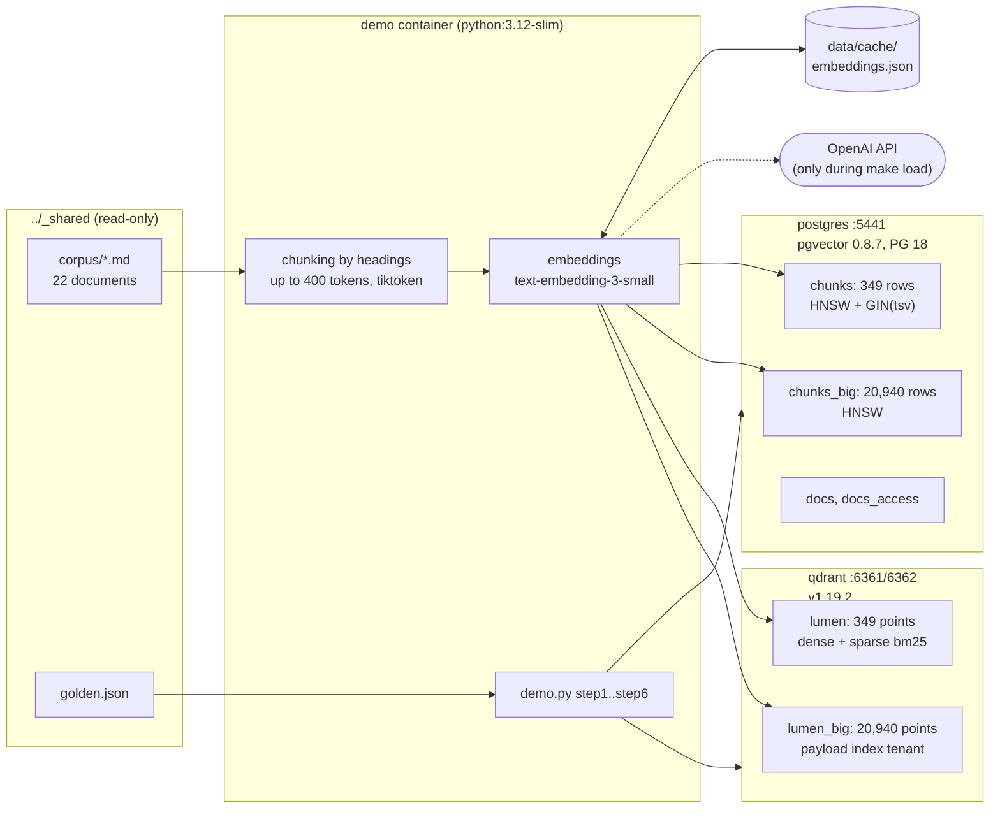

# Demo 03. PostgreSQL + pgvector vs Qdrant

The same Lumen corpus chunks and the same `text-embedding-3-small` embeddings are loaded into Postgres (pgvector) and Qdrant. The steps show where Postgres is enough and even more convenient, and where the territory of a separate vector DB begins.

The stand is local, the OpenAI key is needed once for `make load` (after that everything comes from the `data/cache/` cache). The detailed script for the lecture, real outputs and fallback moves are in [RUNBOOK.md](RUNBOOK.md).

## What it proves (tied to the lecture)

Lecture M2, part 3 "Inside a vector DB", and part 4 "Hybrid" (RRF).

| Step | What you see | Lecture thesis |
|---|---|---|
| 1 | A `chunks` table with `vector(1536)` and `tsvector` next to the text; a Qdrant collection with an unnamed dense vector and a sparse `bm25` | A vector DB = point storage + index + filters; in Postgres that is a column and an index |
| 2 | The same top-5 with the same cosine; `EXPLAIN`: on 349 rows Seq Scan, on 21K - Index Scan over HNSW | An index is approximate search; the planner decides by itself |
| 3 | A document and its chunks change in one transaction (failure → nothing is lost); access rights - `JOIN docs_access` | "The data is already in Postgres - pgvector": transactions and business tables for free |
| 4 | A filter on 5% of rows + HNSW: asked for 5, got 2.4 on average; `hnsw.iterative_scan = relaxed_order` returns 5; Qdrant with a payload index - 5 | A filter is part of the search, not post-processing; "asked for 5, got 2" |
| 5 | Hybrid in one SQL (FTS + vector + RRF in a CTE) vs `prefetch` + `rrf` in Qdrant, recall@5 on the golden set | Hybrid = two searches + rank-based fusion; the `websearch_to_tsquery` trap (AND of all words) |
| 6 | Live checks: `vector(3072)` cannot be indexed (limit 2000), `halfvec(3072)` can; `maintenance_work_mem`, `shm_size`, backups | How the systems differ in operation |

## Architecture



## Components and ports

| Component | Image | Host port | Why |
|---|---|---|---|
| postgres | `pgvector/pgvector:0.8.7-pg18` | `127.0.0.1:5441` | pgvector, FTS, business tables; `shm_size: 1g`, `maintenance_work_mem=512MB` |
| qdrant | `qdrant/qdrant:v1.19.2` | `127.0.0.1:6361` (REST, Dashboard `/dashboard`), `127.0.0.1:6362` (gRPC) | dense + server-side `Qdrant/bm25`, payload filters |
| demo | built from the `Dockerfile` (`python:3.12-slim` + `requirements.txt`) | — | CLI with `rich` output; started via `docker compose run` |

Postgres login: `demo` / `demo`, database `lumen`. Inside the compose network the CLI connects to `postgres:5432` and `qdrant:6333`.

## Files

| File | What is inside |
|---|---|
| `docker-compose.yml` | postgres, qdrant, demo (profile `cli`) |
| `Dockerfile`, `requirements.txt` | the CLI image, versions pinned |
| `Makefile` | `up`, `load`, `step1`..`step6`, `all`, `psql`, `backup`, `down`, `clean` |
| `demo.py` | all steps; SQL and JSON queries are printed before execution |
| `common.py` | chunking, embedding cache with retry on 429, Postgres and Qdrant clients (Qdrant over REST, request bodies as in curl) |
| `sql/schema.sql`, `sql/indexes.sql` | Postgres schema and indexes |
| `.env.example` | `OPENAI_API_KEY=` |
| `data/cache/` | embedding cache (in `.gitignore`) |
| `data/out/` | `load_stats.json`, the `make backup` dump (in `.gitignore`) |

## Quick start

```bash
cd M2-Ilya/demo/03-pgvector-vs-qdrant
cp .env.example .env            # fill in OPENAI_API_KEY (or export in the shell)
make up                         # containers + CLI image build, ~1 min the first time
make load                       # ~50 s; OpenAI is called only for what is not in the cache
make step1                      # ... step6, each step 5-9 s
make clean                      # stop and remove the volumes; the embedding cache stays
```

Your own question for step 2: `docker compose run --rm demo python demo.py step2 "your question"` (a key is needed if the question is not in the cache).

## Synthetic data for step 4 (what was done and why)

On 349 rows the effect of a filter is not visible, so `make load` builds `chunks_big` and `lumen_big`: every chunk is copied for 60 synthetic tenants (`tenant-000`..`tenant-059`), 20,940 rows. Each copy = the original vector + a random other chunk with weight 0.3-0.6 + Gaussian noise, then normalization. Pure near-duplicates (60 identical vectors per chunk) break the HNSW graph, and on them iterative scan found the wrong neighbors. The step 4 filter is 3 tenants out of 60, i.e. 5% of rows.

Two settings without which the effect cannot be shown honestly:

- **Postgres:** on 21K rows the pgvector 0.8 planner itself chooses Seq Scan for a 5% filter (exact and 10-70 ms). Step 4 first shows this, and then switches Seq Scan off (`SET LOCAL enable_seqscan = off`) to see the HNSW behavior that on millions of rows the planner will choose by itself.
- **Qdrant:** `lumen_big` has `hnsw_config.full_scan_threshold = 10` (KB). With the default (10,000 KB) Qdrant would answer a filter on ~1K points with an exact scan over the payload index, and we would not see filterable HNSW itself.

## Where Postgres is enough and where a separate vector DB is needed

A rule of thumb from experience and the documentation, not a benchmark. The numbers are orders of magnitude.

| Postgres + pgvector is enough when... | Move to a separate vector DB when... |
|---|---|
| The data and access rights are already in Postgres, you need a JOIN with business tables and transactions | Vectors are a separate search product, the business data lives in other systems |
| Up to a few million vectors on one machine | Tens and hundreds of millions of vectors, sharding and replicas specifically for search |
| Filters are not too selective or are solved by `iterative_scan`, a partial index, per-tenant partitions | Many selective filters and tenants in one collection: filterable HNSW, `is_tenant` |
| Dimensionality up to 2000 (`vector`) or up to 4000 (`halfvec`) | Models with 3072+ dimensions without compression, multivectors (ColBERT), several named vectors per point |
| Hybrid is fine as Postgres FTS + RRF in SQL | You need BM25 and sparse vectors on the server, built-in `prefetch` + `fusion`, quantization with rescoring |
| One system for backups, monitoring and access - already set up | The team is ready to run one more service: snapshots, versions, monitoring |

For the M2 homework the path is Qdrant (hybrid and BM25 on the server, a Web UI for submission); pgvector is an option for a project, not a replacement for the homework.

## Verified

Run of 2026-11-01: `make clean && make up && make load`, then `make step1`..`make step6` without a key (from the cache) - no errors. Real outputs and figures are in [RUNBOOK.md](RUNBOOK.md).
