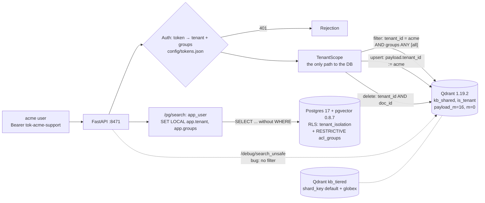

# Demo 04 · Multi-tenancy in a vector DB: how to isolate customers and how it breaks

Lab 04 (local demo) for part 10 of the M2 lecture ("[advanced] Multi-tenancy and access rights"). Outside the timing: for a walkthrough, a recording or a separate session.

Scenario: we are a B2B support platform with three customers (tenants): **acme**, **globex**, **initech**. Each has its own knowledge base, a variant of the Lumen help center from `../_shared/corpus` with its own support hours, refund window and product name. Each also has a secret page `*-internal-pricing.md` with a unique discount code, visible only to the `finance` group. So any leak is immediately visible: a foreign code shows up in the results.

| Tenant | Product | Support hours | Window for an invoice error | Secret code (`finance` only) | Chunks |
|---|---|---|---|---|---|
| acme | Acme Orders | Mon–Sat 07:00–19:00 UTC | 30 days | `ACME-FIN-7731` | 64 |
| globex | Globex Warehouse | Mon–Fri 06:00–22:00 UTC | 21 days | `GLOBEX-VIP-2026` | 92 (the "large" tenant) |
| initech | Initech Ledger | Mon–Fri 10:00–16:00 UTC | 7 days | `INITECH-TPS-0042` | 56 |

## What the demo proves

1. **A tenant index is not access control.** A shared Qdrant collection with `tenant_id` (`keyword`, `is_tenant: true`) and `hnsw_config {payload_m: 16, m: 0}` isolates customers only when the server adds the filter to every query.
2. **The typical bug is a forgotten filter.** The acme user is authenticated, but the endpoint without a filter returns 6 foreign chunks out of 8, including the codes `INITECH-TPS-0042` and `GLOBEX-VIP-2026`.
3. **The tenant comes only from the token.** `?tenant_id=globex`, the `X-Tenant-Id` header and `tenant_id` in the upsert body are ignored. Delete by `doc_id` also carries the tenant filter: `doc_id` is not unique across tenants.
4. **Permissions inside a tenant are a second filter.** Acme support does not see the `finance` page, acme finance does.
5. **The isolation test catches the bug.** 91 tests pass on the safe path. On the buggy path the same isolation tests give 60 failures.
6. **Offboarding is deletion by tenant filter with a counter check.** The script also prints what it does not clean: cache, backups, logs.
7. **Tiered multi-tenancy (Qdrant 1.16+).** Small tenants live in a shared fallback shard, the large tenant globex is moved to a dedicated shard without downtime. The query code stays the same for all tenants.
8. **Shared IDF.** By default BM25 computes IDF over the whole collection, so a word that is frequent at a neighbor loses weight for you too. Qdrant 1.19 has `params.idf.corpus`, and with it the ranking for acme changes.
9. **pgvector + Row Level Security.** A query without `WHERE` returns only the rows of its own tenant. If the tenant is not set, the query returns 0 rows (fail closed). The policy rejects a write into another tenant. RLS + HNSW without iterative scan returns 3 rows instead of 10.

## Architecture



## Components and ports

| Service | Image | Host port | Purpose |
|---|---|---|---|
| qdrant | `qdrant/qdrant:v1.19.2` | 6371 (REST, Web UI `/dashboard`), 6372 (gRPC) | shared collection `kb_shared` and `kb_tiered` |
| postgres | `pgvector/pgvector:0.8.7-pg17` | 5451 | table `chunks` with RLS, role `app_user` |
| api | `python:3.12-slim` + `requirements.txt` | 8471 | `/search`, `/docs`, `/pg/search`, `/debug/search_unsafe` |
| tools | same image, profile `tools` | — | seed, demo scripts, pytest (`docker compose run`) |

Qdrant runs in distributed mode with a single node (`QDRANT__CLUSTER__ENABLED=true`). Without this, shard keys cannot be created: in standalone mode `PUT /collections/{c}/shards` answers "Qdrant is running in standalone mode" (checked on 1.19.2). The other steps work the same in both modes.

Embeddings are OpenAI `text-embedding-3-small` (1536). The cache lives in `data/cache/embeddings/`, one file per text: 222 files, about 7 MB. The key is needed only to fill the cache the first time. After that all steps, including the tests, work offline.

## Files

```
04-multitenancy/
  README.md, RUNBOOK.md, SPEC.md
  docker-compose.yml, Dockerfile, requirements.txt, Makefile, .env.example, .gitignore
  tenants/tenants.json            variant rules: which Lumen docs to take, what to replace
  tenants/<tenant>/*.md           documents of this tenant only (internal-pricing with groups: finance)
  corpus/<tenant>/*.md            generated by seed (in .gitignore)
  config/tokens.json              static tokens → tenant + groups
  config/demo_queries.json        questions for the demo and tests (cached by seed) + probe document
  sql/01-init.sql                 pgvector, table chunks, RLS policies, role app_user
  app/settings.py                 environment variables
  app/embeddings.py               OpenAI + file cache + retries on 429/5xx
  app/sparse.py                   BM25 weights for the sparse vector (Qdrant computes IDF)
  app/corpus.py                   building tenant corpora, chunking by H2
  app/qdrant.py                   Qdrant REST client (JSON as in the documentation)
  app/tenancy.py                  token → Principal, TenantScope (filter in search/upsert/delete), unsafe_search
  app/api.py                      FastAPI
  app/pg.py                       pgvector: SET LOCAL app.tenant + search without WHERE
  app/seed.py                     corpus → embeddings → Qdrant + Postgres
  scripts/leak_demo.py            one question through the chosen endpoint, marking "own / foreign"
  scripts/acl_demo.py             support and finance of one tenant
  scripts/idf_demo.py             global IDF vs. tenant IDF
  scripts/tiered.py               shard keys, moving globex to a dedicated shard
  scripts/rls_demo.py             RLS: superuser, fail closed, search without WHERE, WITH CHECK, HNSW < k
  scripts/offboard.py             tenant deletion and counter check
  tests/test_isolation.py         tests "tenant A does not see B"
```

## Quick start

```bash
cd M2-Ilya/demo/04-multitenancy
export OPENAI_API_KEY=...        # only on the first run, to fill the cache (or .env, see .env.example)
make up                          # qdrant + postgres + api, waits for /health
make seed                        # 212 chunks in Qdrant and Postgres
make leak && make fixed          # the leak and the fixed path
make acl                         # support and finance inside acme
make test                        # 91 passed
make test-buggy                  # 60 failed on the endpoint without a filter
make idf && make tiered && make rls
make offboard                    # delete initech; restore: make seed
make clean                       # docker compose down -v (the embedding cache in data/ stays)
```

Step order, expected output and what to say are in [RUNBOOK.md](RUNBOOK.md).

## The trade-off of `payload_m: 16, m: 0`

- `m: 0` disables the global HNSW graph. `payload_m: 16` builds a separate graph for each value of the field with `is_tenant`. A query with the tenant filter walks the small graph of that tenant: it is fast, and neighbors in the graph do not leak.
- A query without the tenant filter does not break but becomes slow: there is no global graph, only a brute-force scan is left. The documentation: "Global requests (without the `group_id` filter) are slower, since they require scanning all groups". So cross-tenant analytics and admin queries are expensive.
- If you set only `m: 0` without `payload_m`, `payload_m` is taken from `m`, i.e. also 0. Then there will be no graph at all.
- The speed difference is not visible in the demo: 212 points is below `indexing_threshold`, so Qdrant does not build HNSW at all and the search is exact. The demo shows configuration and isolation, not performance.

## Comparison of approaches

| Approach | Isolation | Tenant deletion | Tenant scale | Risks | Where |
|---|---|---|---|---|---|
| Collection (index) per tenant | physical | `DELETE` the collection | tens to hundreds. Qdrant Cloud: up to 1000 collections per cluster by default | overhead for every collection, schema migrations N times. Qdrant officially does not recommend it | few large customers with strict requirements |
| Shared collection + tenant field + server-side filter | logical (filter) | delete by filter | millions | forgotten filter = leak; "noisy neighbor"; shared IDF; shared backups | Qdrant `is_tenant`, pgvector + RLS, Milvus partition key |
| Shard or namespace per tenant | physical, routing by key | one operation on the shard or namespace | thousands to millions (depends on the system) | routing is required; limits on the number of shards | Qdrant tiered, Weaviate, Pinecone, turbopuffer |

How this looks in other systems (not run, documentation only, checked 01.11.2026):

| System | Mechanism | Key facts | Documentation |
|---|---|---|---|
| Qdrant | payload `is_tenant` + `payload_m`; custom sharding; tiered multitenancy (1.16+) | "The index is not access control"; no more than a thousand dedicated shards per cluster; moving a tenant to its own shard makes sense from roughly 20,000 points | https://qdrant.tech/documentation/guides/multiple-partitions/ |
| Pinecone | namespace per tenant in a serverless index | "Each namespace is stored separately… physical isolation"; offboarding `index.delete(delete_all=True, namespace='tenant1')`; a query costs 1 RU per 1 GB of namespace, so filtering a shared 100 GB namespace costs 100 RU; the namespace limit depends on the plan (Starter 100, Standard 100,000) | https://docs.pinecone.io/guides/index-data/implement-multitenancy |
| Weaviate | native tenants: each tenant is its own shard | "Deleting a tenant deletes the associated shard"; states ACTIVE / INACTIVE / OFFLOADED (offload to S3); `coll.with_tenant("A")`; 50,000+ active shards per node | https://docs.weaviate.io/weaviate/concepts/data#multi-tenancy |
| Milvus | partition key (`is_partition_key=True`), also a database, collection or partition per tenant | partition key is designed for millions of tenants, without per-tenant RBAC; `partitionkey.isolation` builds an index per key value (HNSW only) | https://milvus.io/docs/multi_tenancy.md · https://milvus.io/docs/use-partition-key.md |
| turbopuffer | namespace per tenant, no limit on the number of namespaces ("seen: 250M+") | a query is billed by namespace size, but not less than 1.28 GB; customers include Notion (10M+ namespaces) and Linear (4M+) | https://turbopuffer.com/docs/limits · https://turbopuffer.com/pricing |
| pgvector | Row Level Security | Supabase policy for RAG; with HNSW the filter is applied after the index, so without `hnsw.iterative_scan` the result can be shorter than k | https://supabase.com/docs/guides/ai/rag-with-permissions · https://github.com/pgvector/pgvector |

## What is not demonstrated

- **The speed of `m: 0` without a filter and the on-disk gain of `is_tenant`.** On 212 points HNSW is not built, the difference cannot be measured. Hundreds of thousands of points are needed; that is the topic of demo 02.
- **Tiered multi-tenancy on several nodes.** The mechanics (shard key, `Partial` → `Active`, `replicate_points`, fallback cleanup) are shown on a single-node cluster. Moving a shard between nodes and `replication_factor > 1` are not shown.
- **Real authentication.** Static tokens are used instead of JWT/OIDC. In production, tenant and groups come from verified claims.
- **Tenant check when reading by point ID** (`GET /points/{id}`). There is no such endpoint; the rule is described in SPEC.md.
- **Snapshots, backups and logs during offboarding.** The script lists them but does not clean them.
- **Qdrant's own JWT RBAC** (keys with collection-level access). Not used: it does not replace per-tenant isolation inside a collection.

## Links

- Qdrant multitenancy: https://qdrant.tech/documentation/guides/multiple-partitions/
- Qdrant 1.16 (tiered multitenancy): https://qdrant.tech/blog/qdrant-1.16.x/
- Qdrant guidance "The index is not access control": https://qdrant.tech/llms.txt
- pgvector (filtering, iterative scan): https://github.com/pgvector/pgvector
- Postgres RLS: https://www.postgresql.org/docs/17/ddl-rowsecurity.html
- Supabase RAG with permissions: https://supabase.com/docs/guides/ai/rag-with-permissions
- OWASP LLM08:2025 Vector and Embedding Weaknesses: https://genai.owasp.org/llmrisk/llm082025-vector-and-embedding-weaknesses/
- Pinecone, Weaviate, Milvus, turbopuffer: in the table above.
