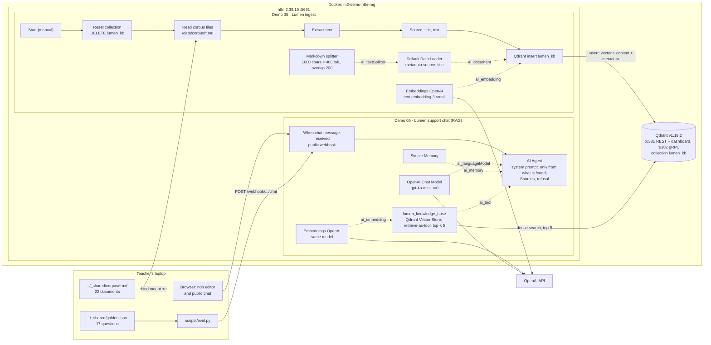

# Demo M2-05: end-to-end RAG in n8n without code

A self-contained n8n + Qdrant demo stand: one workflow fills the knowledge base from 22 documents about the fictional SaaS "Lumen" (`../_shared/corpus/`, read-only), the second is a chat agent that searches this base with the Qdrant Vector Store node and answers with a source, and refuses on a trap question. The third part runs the golden set (`../_shared/golden.json`) through the agent with a small Python script.

The demo script, the real output and the fallbacks are in [RUNBOOK.md](RUNBOOK.md).

## What the demo proves

| What you see | Lecture part | Homework |
|---|---|---|
| Ingestion is built from ready-made nodes: files → loader → splitter → embeddings → Qdrant, 211 points in 12 s | 7 · RAG as a system (loading and chunking) | part 2 (for comparison: in the homework ingestion is a script) |
| A point in Qdrant: unnamed dense 1536 Cosine, payload `content` + `metadata` (`source`, `title`) — exactly the schema the n8n node expects | 3 · Vector DB; 8 · Demo 3 | part 2, requirements for the payload and the vector name |
| The AI Agent calls the tool `lumen_knowledge_base` (Qdrant Vector Store, mode "Retrieve Documents (As Tool for AI Agent)", top-k 5) and answers with `Sources: <file>.md` | 8 · Homework live | part 3, connecting Qdrant to the agent |
| Trap "How do I connect Lumen to Salesforce?" → `I could not find this in the Lumen knowledge base.` | 8; 13 · Silent failures (refusal by prompt) | part 3, refusal on traps |
| `make eval`: 17 golden-set questions, a table "expected / tool found / agent cited / refusal" | 7 · Evaluating retrieval and answer | part 3, running the golden set through the agent |
| The first version of the prompt refused on a question whose answer is in the base (m01): refusal by prompt breaks in both directions | 13 · Silent failures | part 3, analysis of the worst question |

This is a fallback for demo 3 from part 8 (`draft.md`): if the demo repo `Smart-Technical-Support` does not come up, this stand shows the same chain without MCP, without tickets and without code of your own.

## Architecture



Two paths. **Ingestion (offline):** Start → collection reset → file reading → fields `source`/`title`/`text` → the loader cuts the text with the splitter and attaches metadata → embeddings → insert into `lumen_kb`. **Query (online):** a question in the chat → the agent calls the tool → the tool embeds the query with the same model and takes the top-5 from Qdrant → the agent answers from what was found and lists `Sources`.

## Components and ports

| Component | Where | Port (127.0.0.1 only) | Why |
|---|---|---|---|
| n8n `n8nio/n8n:2.39.10` | Docker, container `m2-demo-n8n-rag-n8n`, volume `n8n_data` | 5681 | Both workflows, the editor, the public chat |
| Qdrant `qdrant/qdrant:v1.19.2` | Docker, container `m2-demo-n8n-rag-qdrant`, volume `qdrant_data` | 6381 (REST and `/dashboard`), 6382 (gRPC, not used) | Collection `lumen_kb` |
| OpenAI `text-embedding-3-small`, `gpt-4o-mini` | cloud | — | Embeddings at load and search time, the agent's model |
| `scripts/eval.py` | host, Python 3 without dependencies | — | Runs the golden set through the webhook |

Inside the Docker network n8n reaches Qdrant by the name `http://qdrant:6333`. The ports do not overlap with smart-support (5678, 6333), the M1 demo (5679) and demos 01–04.

The variables are named `DEMO05_*`, not `N8N_PORT` or `QDRANT_PORT`: the `.env` of the demo repo sets `N8N_PORT=5678`, and the script would silently go to someone else's n8n (this is what happened on the first build of the stand).

## Files

| File | What is inside |
|---|---|
| `docker-compose.yml` | n8n + Qdrant, volumes, corpus mount `:ro`, a fixed `N8N_ENCRYPTION_KEY`, telemetry off, `N8N_RESTRICT_FILE_ACCESS_TO=/data/corpus` |
| `Makefile` | `up`, `setup`, `ingest`, `chat-url`, `ask Q=...`, `eval [ONLY=q02,t01]`, `status`, `logs`, `down`, `clean` |
| `.env.example` | `OPENAI_API_KEY` (empty), `DEMO05_*`: encryption key, owner login, ports |
| `workflows/lumen-ingest.json` | The ingestion workflow, id `demo05LumenIngest` |
| `workflows/lumen-chat.json` | The chat agent, id `demo05LumenChat`, webhookId `d05c4a70-0000-4000-8000-000000000005` |
| `credentials/credentials.template.json` | A template of the OpenAI and Qdrant credentials with the placeholder `${OPENAI_API_KEY}`: there is no key in the file |
| `scripts/setup.sh` | Owner via REST, import of credentials and workflows via the n8n CLI, publishing the chat, restart |
| `scripts/ingest.sh` | `n8n execute --id=demo05LumenIngest` and a report on the collection |
| `scripts/eval.py` | The golden set through the webhook, a table in stdout and `runs/eval-*.md` |
| `runs/eval-20261101-1558.md` | A real run with the final prompt: 17/17 |
| `runs/eval-20261101-1554-prompt-v1.md` | A real run with the first version of the prompt: 16/17, a false refusal on m01 |

The OpenAI key is not stored in any project file. `setup.sh` copies the template into the container, substitutes the key from an environment variable inside the container (`docker exec -e OPENAI_API_KEY ... node`), imports the credentials and immediately deletes the filled-in file. After that the key lives only in the encrypted n8n database in the `n8n_data` volume. `.env` is in `.gitignore`.

## Quick start

```bash
cd M2-Ilya/demo/05-n8n-rag
cp .env.example .env            # put in OPENAI_API_KEY or export it in the shell
make up                         # ~25 s until n8n is ready
make setup                      # ~35 s: owner, credentials, both workflows, publishing the chat
make ingest                     # ~12 s: 211 points in lumen_kb
make ask Q="How do I connect Lumen to Salesforce?"
make eval                       # ~55 s: 17 questions, a table in runs/
make chat-url                   # addresses of the editor, the chat and the Qdrant dashboard
make clean                      # wipe everything together with the volumes
```

Editor login: `http://localhost:5681`, `demo@example.com` / `Demo05Lumen2026` (a demo account, the stand listens on loopback only).

## Limitations

- **Dense only.** The Qdrant Vector Store node in n8n searches with a single unnamed dense vector: there is no BM25, no sparse, no hybrid and no RRF in its schema. In the homework hybrid and recall@5 are computed by your own script (part 2), while n8n in part 3 gets a plain dense search. Hybrid live is in demo 01 (`../01-embeddings`, `make step6`: dense / bm25 / prefetch + RRF side by side). The hybrid numbers from the script and the agent's answers through the dense node are two different paths, so label which path produced a number.
- **Payload keys.** The node writes and reads `content` (the chunk text) and `metadata` (everything else). If ingestion is your own script, the payload must have the same two keys, otherwise the agent gets empty fragments; other names are set in the node options `Content Payload Key` / `Metadata Payload Key`.
- **Unnamed dense vector.** The node sends the vector without a name. If the collection has a named dense vector, the search fails. Checked on this stand (Qdrant 1.19.2, n8n 2.39.10): Qdrant itself answers `400 Wrong input: Not existing vector name error: `, and the n8n node shows `Bad request - please check your parameters`. The homework text gives the wording `Collection requires specified vector name in the request`: other Qdrant versions have different text, the meaning is the same.
- **The same embedding model** in ingestion and in the search node: another model (or another dimension) is another space, and the search will silently return junk or fail on the dimension.
- **Refusal by prompt.** The refusal phrase is built into the system prompt and works on gpt-4o-mini at temperature 0, but it breaks in both directions: the first version of the prompt refused on m01, where the answer is in the base (`runs/eval-20261101-1554-prompt-v1.md`). In the homework the refusal is done by the prompt; in production it is a separate check before the model call (a score threshold, a classifier).
- **n8n Cloud does not see localhost.** This stand is entirely local; cloud n8n cannot reach `localhost:6381`. For Cloud use a tunnel, Qdrant Cloud or a self-hosted n8n next to Qdrant (as in the homework requirements).
- **The splitter counts characters, not tokens.** 1600 characters ≈ 400 tokens in English text; the exact length in tokens is not controlled here (in demo 01 and the homework it is `tiktoken` `cl100k_base`). The fact: 211 chunks, 132 / 1096 / 1597 characters (min / avg / max).
- **The scoring in `eval.py` is coarse:** PASS = at least one expected file is cited and there is no refusal (for a trap, the refusal phrase is present). The correctness of the facts in the answer is not checked; a human does that using the "Answers" section of the report.
- **The agent cites extra documents:** `Sources` sometimes includes a document that the tool returned but that is not really needed (q02 → `account-and-login.md`). It does not affect PASS, but for the "source" in the homework it is a reason to look at the prompt.
